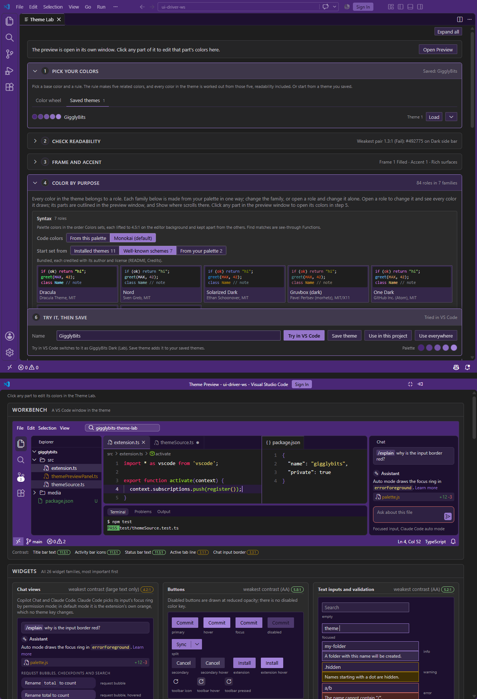

# GigglyBits Theme Lab

Design your own dark VS Code theme, see it on a whole VS Code window as you go, and give each project a color of its own.

## Why this exists

If you've ever installed a theme and never been quite happy with it, or wasted an afternoon installing and uninstalling themes trying to find one that suits you, this is for you. Maybe you loved the editor but hated the title bar. Maybe the comments were too dark to read, or the theme only covered half the window and the rest fell back to colors that clashed. Fixing any of that meant hand-editing `workbench.colorCustomizations`, guessing which of hundreds of keys drew the thing you were looking at, and switching windows to see what changed. Every project window looked the same, so you typed into the wrong one. And changing themes changed your code colors too, so nothing ever quite felt like yours.

GigglyBits Theme Lab fixes all of that.

## What it does

- **A whole theme from five colors.** Pick a base color and a color-wheel rule, and the Lab works out every part of the theme from it. Text and code colors are lightened until they're readable, so you can't make a theme you can't read.
- **A live preview of the whole window.** The Theme Preview draws a full VS Code window and every kind of widget in your colors, and updates as you drag. Click any part of it to change just that color.
- **Try it for real, straight away.** One click applies your design to the window you're in, with no reload.
- **A color for each project.** Give a theme a filled frame and use it in a project: that window's title bar, activity bar and status bar take the frame color, so you can tell windows apart at a glance.
- **Code colors that stay put.** Save your code colors as a syntax set and every theme can use it, so code looks the same in every project. Start one from a theme you already have installed, or from Dracula, Nord, Solarized and other well-known schemes.
- **Nothing to manage.** Saved themes live in your user settings, so Settings Sync carries them to your other machines. There are no files to copy and nothing extra to install.

## Getting started

Run **GigglyBits: Open Theme Lab** from the Command Palette. The Lab walks you through the rest.

Your saved themes appear in **Preferences: Color Theme** as GigglyBits Theme 1 to 12. **GigglyBits: Choose Theme** lists them by their real names.

## Requirements

VS Code 1.90 or later, in a trusted workspace.

## Credits

The well-known schemes you can start a syntax set from are bundled under their own permissive licenses. Where a scheme publishes syntax guidance, its colors follow it; otherwise they come from its Base16 port in the tinted-theming schemes collection (https://github.com/tinted-theming/schemes, MIT).

- **Dracula** by Dracula Theme, MIT, https://github.com/dracula/dracula-theme
- **Nord** by Sven Greb, MIT, https://github.com/nordtheme/nord
- **Solarized Dark** by Ethan Schoonover, MIT, https://github.com/altercation/solarized
- **Gruvbox (dark)** by Pavel Pertsev (morhetz), MIT/X11, https://github.com/morhetz/gruvbox
- **One Dark** by GitHub Inc. (Atom), MIT, https://github.com/atom/one-dark-syntax
- **Tokyo Night** by Enkia, MIT, https://github.com/tokyo-night/tokyo-night-vscode-theme
- **Catppuccin Mocha** by Catppuccin, MIT, https://github.com/catppuccin/catppuccin

## License

MIT. Source and issues: https://github.com/websolete/gigglybits-theme-lab
